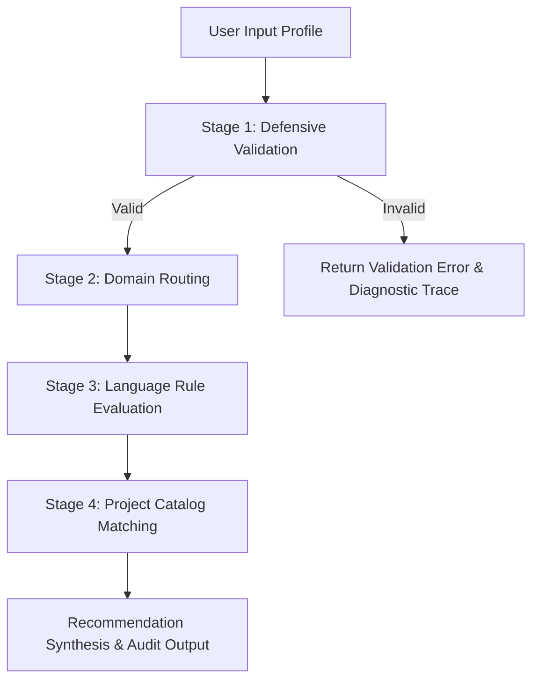

# RuleRoute — Programming Language & Project Recommendation System

> **"Find your language. Discover your next project."**  
> A transparent, deterministic, rule-based recommendation platform that connects programming interests with suitable languages and practical project ideas.

[](https://www.python.org/)
[](https://streamlit.io/)
[](https://pytest.org/)
[](#system-architecture)

---

## 1. Project Overview

**RuleRoute** is an architectural evolution of an academic knowledge-based system designed to guide computer science undergraduates and aspiring developers toward appropriate programming languages and capstone project ideas.

Unlike opaque machine learning models or generative AI chat interfaces that often hallucinate non-existent libraries or ungrounded project scopes, RuleRoute operates as a **deterministic production system** using propositional logic. Every recommendation is accompanied by an **execution decision trace**, demonstrating exactly which rule conditions and user attributes triggered each suggestion.

---

## 2. Problem Statement

Undergraduate engineering students frequently struggle with two interconnected dilemmas:
1. **Language Choice Disconnect:** Choosing a programming language without considering the target domain ecosystem, system performance requirements, or their personal experience level.
2. **Project Scoping Misalignment:** Selecting capstone or portfolio projects that are either too trivial (failing to demonstrate depth) or unrealistically ambitious (resulting in abandoned efforts).

Most existing recommendation tools rely either on generic keyword search or probabilistic black-box algorithms that cannot explain their reasoning. Students and evaluators require a **transparent, auditable, and grounded advising engine**.

---

## 3. Project Objectives

- **Deterministic Guidance:** Recommend programming languages and concrete project ideas tailored to a user's domain, skill level, and technical interests.
- **Explainable Reasoning (Zero Hallucination):** Provide a real-time decision audit trace logging every conditional check, passed predicate, and omitted alternative.
- **Architectural Modularity:** Decouple the knowledge base, input validation, propositional rules, and diagnostics from the presentation layer.
- **Presentation-Ready UX:** Deliver a refined developer application featuring high-contrast dual theme support (Light/Dark), instant demonstration scenario loading, full catalog filtering, and exportable audit reports.

---

## 4. Technologies Used

| Layer | Technology | Purpose |
| :--- | :--- | :--- |
| **Language** | Python 3.10 – 3.13 | Core programming language |
| **UI Framework** | Streamlit (v1.35+) | Reactive, component-based developer interface |
| **Testing Suite** | Pytest (v8.0+) | Unit testing, boundary verification, and AppTest integration |
| **Design System** | Custom CSS Variables | Refined developer aesthetics with Light and Dark modes |
| **Serialization** | Python `json` & Markdown | Audit report export utilities |

---

## 5. System Architecture

RuleRoute adheres to a multi-tiered architecture that separates knowledge representation from user interface controls:

```text
RuleRoute/
│
├── app.py                      # Main Streamlit application and layout coordinator
│
├── recommendation_engine/       # Core deterministic recommendation engine
│   ├── __init__.py             # Public API exports
│   ├── catalog.py              # Knowledge base: domains, levels, 18 projects, demos
│   ├── validation.py           # Defensive schema and type boundary enforcement
│   ├── rules.py                # Propositional rule trees and recommendation pipeline
│   └── diagnostics.py          # DecisionTrace real-time audit accumulator
│
├── ui/                         # Presentation components and styling
│   ├── __init__.py             # UI exports
│   ├── theme.py                # Light and Dark theme CSS definitions
│   └── components.py           # Cards, badges, timeline trace, and catalog explorers
│
├── tests/                      # Automated test suite
│   ├── __init__.py
│   ├── test_engine.py          # 29 unit tests covering rules, boundaries, and fallbacks
│   └── test_app.py             # 6 integration tests using Streamlit AppTest framework
│
├── .streamlit/
│   └── config.toml             # Headless server, security, and theme defaults
│
├── requirements.txt            # Production dependencies
├── README.md                   # System documentation and presentation guide
└── .gitignore                  # Clean version control exclusions
```

---

## 6. Supported Domains & Catalog Scope

RuleRoute supports **6 technical domains**, **3 experience tiers**, and **3 project difficulty levels**:

### Supported Domains
1. **AI/ML (Artificial Intelligence & Machine Learning)**
2. **Web Development**
3. **App Development**
4. **Data Science**
5. **Automation**
6. **Game Development**

### Experience Levels
- **Beginner** (Syntax foundations, declarative APIs)
- **Intermediate** (Architecture patterns, multi-tier applications)
- **Advanced** (Low-level systems, concurrency, custom engines)

### Difficulty Tiers
- **Easy** | **Medium** | **Hard**

### The 18 Canonical Projects Catalog
The system maintains the complete 18-project curriculum from the foundational research specification:

| # | Domain | Difficulty | Canonical Project Idea | Suggested Language |
| :-: | :--- | :--- | :--- | :--- |
| 1 | AI/ML | Easy | Smart Vacuum Cleaner Simulation & Reflex Agent | Python |
| 2 | AI/ML | Medium | Adversarial Game Playing Agent with Alpha-Beta Pruning | Python |
| 3 | AI/ML | Hard | Real-Time Edge Computer Vision Pipeline | Python / C++ |
| 4 | Web Development | Easy | Interactive Student Task & Milestone Tracker | JavaScript / HTML / CSS |
| 5 | Web Development | Medium | Collaborative Note-Sharing & Discussion Platform | TypeScript / Node.js / React |
| 6 | Web Development | Hard | Real-Time Collaborative Code Editor | TypeScript / WebSockets / Go |
| 7 | App Development | Easy | Campus Notice & Event Broadcasting App | Dart (Flutter) |
| 8 | App Development | Medium | Personal Expense Tracker & Receipt Scanner | Kotlin (Android) |
| 9 | App Development | Hard | Offline-First Mesh Messenger | Kotlin / Bluetooth LE |
| 10 | Data Science | Easy | Exploratory Analysis of Engineering Placement Trends | Python (Pandas, Seaborn) |
| 11 | Data Science | Medium | Automated Customer Churn & Segmentation Engine | Python & SQL |
| 12 | Data Science | Hard | Real-Time Financial Sentiment & Time-Series Pipeline | Python / Apache Kafka |
| 13 | Automation | Easy | Automated E-Commerce Price Monitor & Notification Bot | Python (BeautifulSoup, Requests) |
| 14 | Automation | Medium | College Submission Format & Plagiarism Validator | Python |
| 15 | Automation | Hard | Automated Cloud Health & CI/CD Orchestration Bot | Python & Bash |
| 16 | Game Development | Easy | 2D Tile-Based Dungeon Explorer | C# (Unity) or Python (Pygame) |
| 17 | Game Development | Medium | 3D Physics Platformer with Dynamic Obstacles | C# (Unity) |
| 18 | Game Development | Hard | Custom OpenGL/Vulkan 3D Rendering Engine | C++ |

---

## 7. Recommendation Engine Logic

The recommendation engine executes sequentially across **4 distinct stages**:



### Stage 1: Defensive Validation (`validation.py`)
- Verifies input is a dictionary structure.
- Checks presence of all 4 required keys (`preferred_domain`, `experience_level`, `preferred_difficulty`, `main_interest`).
- Validates data types (e.g., `main_interest` must be a string).
- Rejects empty strings and whitespace-only inputs.
- Verifies attributes exist within categorical bounds (`SUPPORTED_DOMAINS`, `SUPPORTED_LEVELS`, `SUPPORTED_DIFFICULTIES`).

### Stage 2: Domain Routing (`rules.py`)
- Routes profile execution into the appropriate domain rule sub-tree.

### Stage 3: Language Rule Evaluation
- **AI/ML:**
  - `Python` is selected as the domain baseline ecosystem.
  - `IF level in ['Intermediate', 'Advanced'] THEN` recommend `C++` for tensor engine deployment and edge inference.
- **Web Development:**
  - `IF 'front' in interest OR 'full' in interest OR level == 'Beginner' THEN` recommend `JavaScript / TypeScript`.
  - `IF 'back' in interest OR 'api' in interest OR 'full' in interest THEN` recommend `Python`.
  - `IF level == 'Advanced' AND backend interest THEN` recommend `Go (Golang)` for high-throughput distributed systems.
- **App Development:**
  - `IF 'android' in interest THEN` recommend `Kotlin`.
  - `ELIF 'cross' in interest OR level == 'Beginner' THEN` recommend `Dart (Flutter)`.
  - `ELSE` recommend `Kotlin` (standard native mobile architecture).
- **Data Science:**
  - `Python` is selected as the baseline analytical stack.
  - `IF level in ['Intermediate', 'Advanced'] THEN` recommend `SQL` for relational database warehousing and ETL pipelines.
- **Automation:**
  - `Python` is selected as the premier scripting foundation.
  - `IF level in ['Intermediate', 'Advanced'] THEN` recommend `Bash / Shell` for UNIX server orchestration and CI/CD pipelines.
- **Game Development:**
  - `IF 'unity' in interest OR level in ['Beginner', 'Intermediate'] THEN` recommend `C#`.
  - `IF 'engine' in interest OR level == 'Advanced' THEN` recommend `C++` for Unreal Engine and custom OpenGL/Vulkan rendering engines.

### Stage 4: Project Matching & Fallback Handling
- Queries `PROJECT_CATALOG` for an exact match where `p['domain'] == domain and p['difficulty'] == difficulty`.
- If no exact match is found, invokes fallback: `p['domain'] == domain` to ensure the student is never left without guidance.

---

## 8. Application Features

1. **Editorial Developer Interface:** Clean typography, subtle borders, restrained accents, and zero cluttered or fake metrics.
2. **Dynamic Light & Dark Theme Toggle:** Seamless switching between Light (`#f8fafc`) and Dark (`#0b0f19`) modes, persistent across session reruns.
3. **One-Click Demonstration Profiles:** Instant loading of the 5 canonical scenarios from the original study (including the invalid edge case).
4. **Keyword Advice Assistant:** Dynamic helper card displaying domain keyword patterns and their influence on language rules.
5. **Explainable Decision Trace:** Expandable timeline detailing the exact conditions evaluated, rules triggered, and reasons for omitted alternatives.
6. **Project Catalog Explorer:** Interactive search and multi-faceted filtering (by Domain, Difficulty, and Keyword) across all 18 projects.
7. **Rule Explorer:** Interactive documentation breaking down the 4 pipeline stages and domain logic tables.
8. **Export Utilities:** Instant download of recommendations as Markdown (`.md`) or structured JSON (`.json`) audit reports.
9. **In-Memory Session History:** Review and restore previous recommendation results computed during the active browser session.

---

## 9. Installation & Setup

### Prerequisites
- Python 3.10, 3.11, 3.12, or 3.13 installed.
- Git (optional, for cloning).

### Step 1: Set up Virtual Environment
Open PowerShell or your preferred terminal in the project directory:

```powershell
# Windows
python -m venv .venv
.\.venv\Scripts\Activate.ps1

# Linux / macOS
python3 -m venv .venv
source .venv/bin/activate
```

### Step 2: Install Dependencies
```bash
pip install -r requirements.txt
```

---

## 10. Execution Instructions

Launch the Streamlit web application:

```bash
streamlit run app.py
```

The application will launch automatically in your default browser at:
`http://localhost:8501`

---

## 11. Automated Testing

RuleRoute includes a comprehensive test suite of **35 automated tests** comprising unit tests, boundary validations, and Streamlit `AppTest` integration tests.

Run the test suite via `pytest`:

```bash
pytest -v tests/
```

### Test Coverage Highlights
- **Validation Tests (`test_engine.py`):** Non-dict inputs, missing keys, empty strings, whitespace-only inputs, invalid types, unsupported domains/levels/difficulties.
- **Rule Coverage (`test_engine.py`):** All 6 domains, all 3 levels, all 3 difficulties, keyword triggering (`front`, `back`, `api`, `full`, `android`, `cross`, `unity`, `engine`).
- **Catalog Coverage (`test_engine.py`):** Validates all 18 project entries, verifies exact retrievability, and tests fallback logic.
- **Original Notebook Assertions (`test_engine.py`):** Validates all 5 demonstration profiles and cross-profile diversity assertions.
- **AppTest Integration Tests (`test_app.py`):** App initialization, theme switching, profile submission, demo profile loading, edge case error rendering, and form reset.

---

## 12. College Project Presentation & Viva Guide

### Frequently Asked Viva Questions

**Q1: What is a rule-based expert system, and how does it differ from Machine Learning?**  
*Answer:* A rule-based system uses a declarative knowledge base combined with an inference engine evaluating propositional rules (`IF condition THEN action`). Machine Learning induces statistical correlations from training data. For curricular advising, a rule-based system guarantees deterministic precision, 100% explainability, zero hallucination, and requires no large dataset or costly model training.

**Q2: How does the system achieve explainability?**  
*Answer:* RuleRoute features a dedicated `DecisionTrace` diagnostic accumulator. As rules evaluate, every condition tested and its outcome are chronologically logged and returned to the user interface as an interactive execution audit trail.

**Q3: How are invalid user inputs prevented from crashing the application?**  
*Answer:* The engine implements defensive validation in `validation.py` before any rule execution takes place. It verifies input types, key presence, string emptiness, and categorical set boundaries, returning structured error objects and friendly user alerts.

---

## 13. Project Limitations & Future Scope

### Current Limitations
- **Discrete Catalog:** The catalog currently contains the 18 canonical projects from the initial specification; novel projects require manual knowledge base additions.
- **Session-Bound History:** Recommendation history is stored in Streamlit `session_state` and clears when the browser tab is refreshed.

### Future Scope
- **Domain Rule Customizer:** An administrative interface for educators to dynamically define new domain rules and project ideas via YAML/JSON without altering Python source code.
- **Multi-Factor Weighting:** Optional sub-rules taking into account weekly hours available or specific college semester courses.

---

## 14. License & Academic Integrity

Developed for academic demonstration and mini-project assessment. The original research notebook `09_rule_based_recommendation.ipynb` is strictly preserved and referenced.

