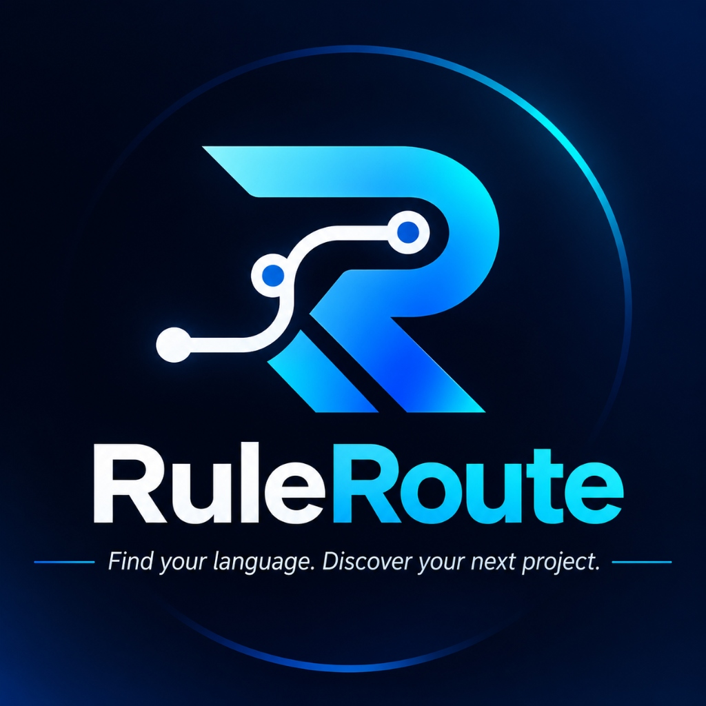
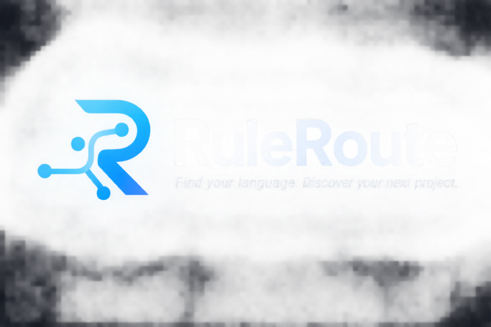
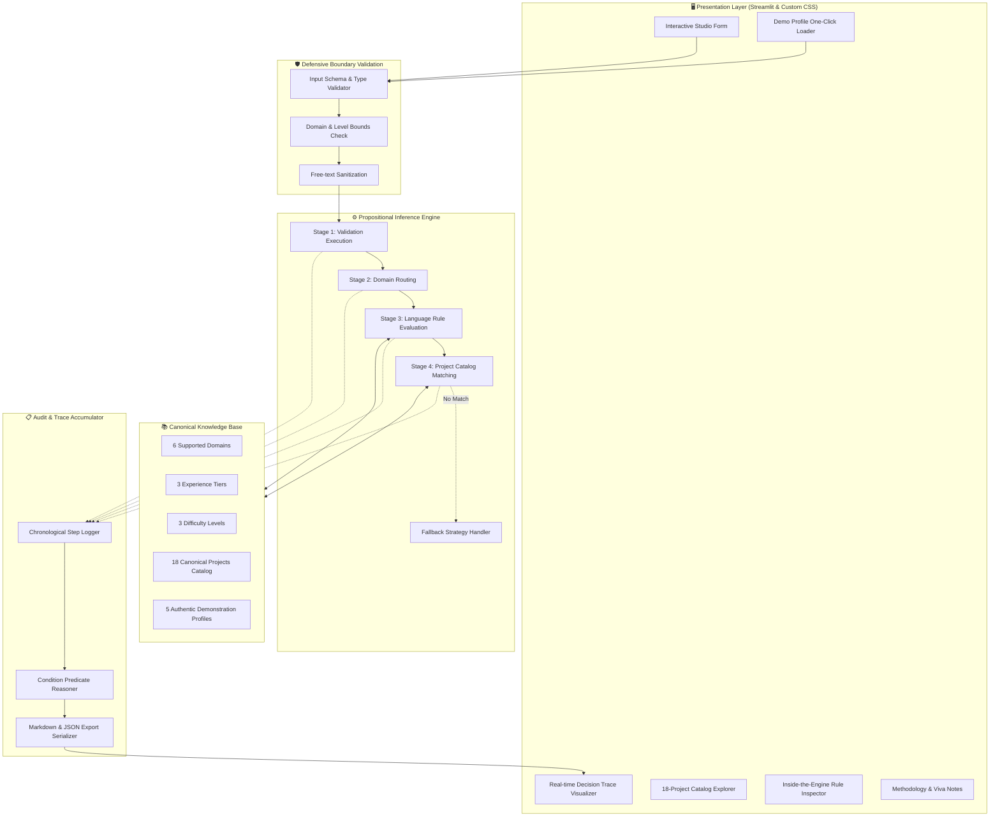
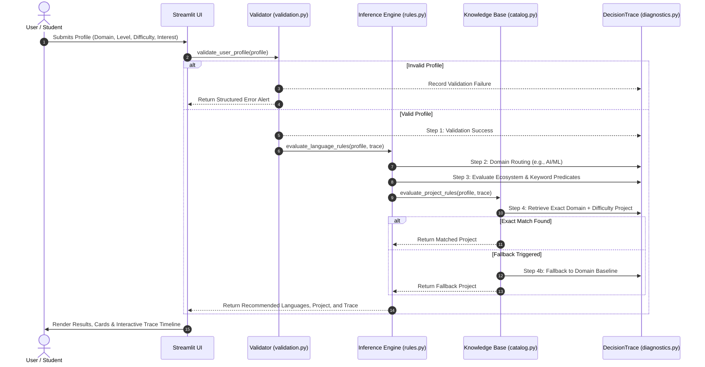

<div align="center">

  

  # RuleRoute

  ### **Find your language. Discover your next project.**

  A deterministic, production-grade **Rule-Based Recommendation Platform** connecting developer interests with optimal programming languages and verified capstone project specifications.

  <p align="center">
    <a href="https://ruleroute-programming-recommender.streamlit.app/" target="_blank">
      
    </a>
    &nbsp;&nbsp;
    <a href="https://ruleroute-programming-recommender.streamlit.app/" target="_blank">
      
    </a>
  </p>

  [](https://ruleroute-programming-recommender.streamlit.app/)
  [](https://www.python.org/)
  [](https://streamlit.io/)
  [](https://pytest.org/)
  [](https://github.com/himanshu-jadhav108/ruleroute-programming-recommender)
  [](https://github.com/himanshu-jadhav108/ruleroute-programming-recommender)
  [](LICENSE)

</div>

---

<p align="center">
  
</p>

---

## 📑 Table of Contents

- [1. Executive Summary](#1-executive-summary)
- [2. Why Rule-Based over Black-Box AI?](#2-why-rule-based-over-black-box-ai)
- [3. Live Deployment & Quick Access](#3-live-deployment--quick-access)
- [4. System Architecture](#4-system-architecture)
- [5. Recommendation Engine Pipeline](#5-recommendation-engine-pipeline)
- [6. Technical Domain & Propositional Rule Matrix](#6-technical-domain--propositional-rule-matrix)
- [7. The 18 Canonical Projects Catalog](#7-the-18-canonical-projects-catalog)
- [8. Application Features & UI Showcase](#8-application-features--ui-showcase)
- [9. Responsive Design & Multi-Device Support](#9-responsive-design--multi-device-support)
- [10. Local Setup & Installation](#10-local-setup--installation)
- [11. Comprehensive Automated Testing Suite](#11-comprehensive-automated-testing-suite)
- [12. College Project Viva & Technical Defense Guide](#12-college-project-viva--technical-defense-guide)
- [13. Repository Structure](#13-repository-structure)
- [14. License & Academic Attribution](#14-license--academic-attribution)

---

## 1. Executive Summary

**RuleRoute** is an architectural modernization of an academic knowledge-based expert system designed to solve two widespread dilemmas faced by undergraduate computer science students:
1. **Language Ecosystem Disconnect:** Selecting a language without considering real-world domain workflows, runtime characteristics, or personal experience tier.
2. **Project Scoping Misalignment:** Choosing capstone projects that are either overly trivial or unrealistically ambitious, leading to incomplete prototypes.

RuleRoute transforms the original academic study (`09_rule_based_recommendation.ipynb`) into an interactive, presentation-ready developer platform. Unlike statistical black-box engines, RuleRoute operates through **pure propositional inference logic**: every recommendation is paired with an auditable **real-time decision trace** that details every conditional check, rule branch, and justification.

---

## 2. Why Rule-Based over Black-Box AI?

In educational and career advising, **explainability and precision are paramount**. The table below illustrates why a deterministic rule-based architecture is superior for curricular recommendation compared to probabilistic Large Language Models (LLMs):

| Dimension | 🧭 RuleRoute (Rule-Based Expert System) | 🤖 Probabilistic LLM / Chatbot |
| :--- | :--- | :--- |
| **Output Determinism** | 🟢 **100% Deterministic** (Identical input = Identical output) | 🔴 **Stochastic** (Output varies with temperature / prompts) |
| **Hallucination Risk** | 🟢 **Zero** (Strictly bounded by verified knowledge base) | 🔴 **High** (Invented libraries, deprecated APIs, fake repos) |
| **Auditability & Trace** | 🟢 **Complete chronological decision trail** for viva evaluation | 🔴 **Opaque latent vectors** with post-hoc ungrounded explanations |
| **Compute & Latency** | 🟢 **Sub-millisecond inference** (< 5ms), zero GPU required | 🔴 **High compute**, multi-second network API latency |
| **Edge-Case Safety** | 🟢 **Defensive schema boundary validation** before evaluation | 🔴 **Unbounded prompts**, vulnerable to prompt injections |
| **Educational Grounding** | 🟢 **18 Curated syllabus-aligned undergraduate projects** | 🔴 Uncalibrated project scopes that exceed semester timelines |

---

## 3. Live Deployment & Quick Access

The application is deployed live on **Streamlit Community Cloud** with continuous deployment from the `main` branch:

> 🌐 **Live Web Application:** [https://ruleroute-programming-recommender.streamlit.app/](https://ruleroute-programming-recommender.streamlit.app/)

- **SEO & Social Sharing Preview:** Configured with Open Graph (`og:image`, `og:title`, `og:description`) and Twitter Cards featuring [`assets/ruleroute-badge.jpg`](assets/ruleroute-badge.jpg).
- **Favicon:** High-resolution RuleRoute emblem badge integrated into browser tab headers.
- **Zero Configuration:** Ready for evaluation on mobile phones, tablets, laptops, and desktop monitors.

---

## 4. System Architecture

RuleRoute enforces a strict separation of concerns between domain knowledge, defensive validation, propositional logic rules, diagnostic tracing, and the responsive presentation layer:



---

## 5. Recommendation Engine Pipeline

The deterministic engine processes user profile attributes through a sequential 4-stage pipeline:



---

## 6. Technical Domain & Propositional Rule Matrix

RuleRoute codifies domain intelligence into deterministic propositional rules (`IF condition THEN recommendation`):

```
+---------------------------------------------------------------------------------------------------+
| DOMAIN           | BASELINE      | LEVEL / KEYWORD CONDITION               | EXPANDED RECOMMENDATION     |
+---------------------------------------------------------------------------------------------------+
| AI / ML          | Python        | Level in [Intermediate, Advanced]       | C++ (High Performance / Edge)|
| Web Development  | JavaScript/TS | Level == Beginner OR 'front' in Interest| JavaScript / TypeScript     |
|                  | Python        | 'back' in Interest OR 'api' in Interest | Python (FastAPI / Django)   |
|                  | Go (Golang)   | Level == Advanced AND Backend Interest  | Go (Concurrent microservices)|
| App Development  | Kotlin        | 'android' in Interest                   | Kotlin (Native Android)     |
|                  | Dart (Flutter)| Level == Beginner OR 'cross' in Interest| Dart (Cross-Platform)       |
| Data Science     | Python        | Level in [Intermediate, Advanced]       | SQL (ETL / Data Warehousing)|
| Automation       | Python        | Level in [Intermediate, Advanced]       | Bash / Shell Scripting      |
| Game Development | C# (Unity)    | Level in [Beginner, Intermediate]       | C# (Unity Engine)           |
|                  | C++           | Level == Advanced OR 'engine' in Interest| C++ (OpenGL / Unreal Engine)|
+---------------------------------------------------------------------------------------------------+
```

---

## 7. The 18 Canonical Projects Catalog

Every project is preserved from the original research curriculum, ensuring authentic undergraduate academic rigor:

| # | Domain | Difficulty | Canonical Project Idea | Recommended Language | Key Curriculum Competencies |
| :-: | :--- | :---: | :--- | :--- | :--- |
| **1** | AI/ML | `Easy` | Smart Vacuum Cleaner Simulation & Reflex Agent | Python | State spaces, PEAS agent modeling, reflex logic |
| **2** | AI/ML | `Medium` | Adversarial Game Playing Agent (Alpha-Beta) | Python | Minimax, alpha-beta pruning, heuristics |
| **3** | AI/ML | `Hard` | Real-Time Edge Computer Vision Pipeline | Python / C++ | OpenCV, frame buffering, edge quantization |
| **4** | Web Development | `Easy` | Interactive Student Task & Milestone Tracker | JavaScript / HTML / CSS | DOM manipulation, LocalStorage, CSS Flexbox |
| **5** | Web Development | `Medium` | Collaborative Note-Sharing Platform | TypeScript / Node.js | REST APIs, JWT authentication, PostgreSQL |
| **6** | Web Development | `Hard` | Real-Time Collaborative Code Editor | TypeScript / WebSockets / Go | Operational Transform / CRDT, WebSockets |
| **7** | App Development | `Easy` | Campus Notice & Event Broadcasting App | Dart (Flutter) | State management, cross-platform layouts |
| **8** | App Development | `Medium` | Personal Expense Tracker & Receipt Scanner | Kotlin (Android) | Room DB, MVVM, CameraX, Android Jetpack |
| **9** | App Development | `Hard` | Offline-First Mesh Messenger | Kotlin / Bluetooth LE | BLE discovery, store-and-forward routing |
| **10** | Data Science | `Easy` | Exploratory Analysis of Placement Trends | Python (Pandas, Seaborn) | Data cleaning, hypothesis testing, EDA |
| **11** | Data Science | `Medium` | Customer Churn & Segmentation Engine | Python & SQL | RFM analysis, scikit-learn clustering |
| **12** | Data Science | `Hard` | Real-Time Financial Sentiment Pipeline | Python / Kafka | Stream ingestion, time-series, NLP pipelines |
| **13** | Automation | `Easy` | E-Commerce Price Monitor & Notification Bot | Python (BS4, Requests) | DOM scraping, scheduling, webhooks |
| **14** | Automation | `Medium` | College Submission & Plagiarism Validator | Python | AST parsing, regex validation, PDF parsing |
| **15** | Automation | `Hard` | Automated Cloud Health & CI/CD Orchestration | Python & Bash | Docker SDK, GitHub Actions, server monitoring |
| **16** | Game Development | `Easy` | 2D Tile-Based Dungeon Explorer | C# (Unity) or Pygame | Grid movement, collision detection, game loops |
| **17** | Game Development | `Medium` | 3D Physics Platformer with Dynamic Hazards | C# (Unity) | Rigidbodies, physics joints, particle systems |
| **18** | Game Development | `Hard` | Custom 3D OpenGL / Vulkan Rendering Engine | C++ | Shader pipelines, matrix math, vertex buffers |

---

## 8. Application Features & UI Showcase

```
+------------------------------------------------------------------------------------+
| 🎯 RECOMMENDATION STUDIO   | 📚 PROJECT CATALOG (18)  | ⚙️ INSIDE THE ENGINE        |
| Interactive Form & Trace   | Search & Faceted Filter  | Propositional Rule Graphs  |
+------------------------------------------------------------------------------------+
| ⚡ One-Click Academic Demo Profiles    | 🕒 In-Memory Browser Session History       |
| 🌓 Dual High-Contrast Theme (Light/Dark)| 📥 Instant Markdown & JSON Export Reports  |
+------------------------------------------------------------------------------------+
```

1. **Academic Demonstration Profiles:** Instant loading of all 5 canonical test profiles from the original notebook, including the intentional invalid edge case (`Quantum Computing`).
2. **Domain Keyword Assistant:** Dynamic guidance box alerting users in real time about keywords (e.g. `front`, `back`, `unity`, `engine`) that trigger conditional rule branches.
3. **Chronological Decision Trace:** Step-by-step visual audit trail displaying the execution status, evaluated condition, and selected outcome for complete transparency.
4. **Faceted Project Catalog Explorer:** Search and filter all 18 canonical projects simultaneously by domain, difficulty tier, and keywords.
5. **Session History Accumulator:** Retain and restore evaluations conducted during the active browser session.
6. **Export Reporting:** Download complete recommendation audits formatted as Markdown (`.md`) or machine-readable JSON (`.json`).

---

## 9. Responsive Design & Multi-Device Support

RuleRoute was engineered mobile-first using modern CSS Flexbox, CSS Grid, and fluid typography.

- **Fluid Typography:** Scales seamlessly using CSS `clamp()` expressions across mobile (320px) to ultra-wide displays (1920px).
- **Touch-Target Accessibility:** Interactive buttons, selects, and tabs enforce a minimum touch target size of 44px for compliant mobile ergonomics.
- **Scrollable Navigation Tabs:** Horizontal overflow prevention with smooth kinetic scrolling for mobile viewports.
- **Dual High-Contrast Theme:** Carefully balanced palette in both Light (`#f8fafc`) and Dark (`#0b0f19`) modes, ensuring full WCAG AA contrast compliance.

---

## 10. Local Setup & Installation

### Prerequisites
- **Python:** 3.10, 3.11, 3.12, or 3.13
- **Operating System:** Windows, macOS, or Linux

### 1. Clone the Repository
```bash
git clone https://github.com/himanshu-jadhav108/ruleroute-programming-recommender.git
cd ruleroute-programming-recommender
```

### 2. Configure Virtual Environment

#### Windows (PowerShell):
```powershell
python -m venv .venv
.\.venv\Scripts\Activate.ps1
```

#### macOS / Linux:
```bash
python3 -m venv .venv
source .venv/bin/activate
```

### 3. Install Dependencies
```bash
pip install -r requirements.txt
```

### 4. Launch Application
```bash
streamlit run app.py
```
Open your browser at `http://localhost:8501`.

---

## 11. Comprehensive Automated Testing Suite

RuleRoute includes an extensive automated test suite of **43 tests** with 100% pass rate:

```bash
pytest -v tests/
```

```text
============================= test session starts =============================
collected 43 items

tests/test_app.py::test_app_loads_successfully PASSED                    [  2%]
tests/test_app.py::test_app_theme_switch PASSED                          [  4%]
tests/test_app.py::test_app_submit_default_profile PASSED                [  6%]
tests/test_app.py::test_app_load_demo_profile PASSED                     [  9%]
tests/test_app.py::test_app_load_invalid_demo_profile PASSED             [ 11%]
tests/test_app.py::test_app_reset_form PASSED                            [ 13%]
tests/test_app.py::test_logo_and_favicon_assets_integrated PASSED        [ 16%]
tests/test_engine.py::test_validate_valid_profile PASSED                 [ 18%]
tests/test_engine.py::test_validate_non_dict_input PASSED                [ 20%]
tests/test_engine.py::test_validate_missing_keys PASSED                  [ 23%]
tests/test_engine.py::test_validate_unsupported_domain PASSED            [ 25%]
tests/test_engine.py::test_validate_unsupported_experience_level PASSED  [ 27%]
tests/test_engine.py::test_validate_unsupported_difficulty PASSED        [ 30%]
tests/test_engine.py::test_validate_empty_and_whitespace_interest PASSED [ 32%]
tests/test_engine.py::test_validate_invalid_interest_type PASSED         [ 34%]
tests/test_engine.py::test_all_supported_domains_evaluate[AI/ML] PASSED  [ 37%]
tests/test_engine.py::test_all_supported_domains_evaluate[Web Development] PASSED [ 39%]
tests/test_engine.py::test_all_supported_domains_evaluate[App Development] PASSED [ 41%]
tests/test_engine.py::test_all_supported_domains_evaluate[Data Science] PASSED [ 44%]
tests/test_engine.py::test_all_supported_domains_evaluate[Automation] PASSED [ 46%]
tests/test_engine.py::test_all_supported_domains_evaluate[Game Development] PASSED [ 48%]
tests/test_engine.py::test_all_supported_levels_evaluate[Beginner] PASSED [ 51%]
tests/test_engine.py::test_all_supported_levels_evaluate[Intermediate] PASSED [ 53%]
tests/test_engine.py::test_all_supported_levels_evaluate[Advanced] PASSED [ 55%]
tests/test_engine.py::test_all_supported_difficulties_evaluate[Easy] PASSED [ 58%]
tests/test_engine.py::test_all_supported_difficulties_evaluate[Medium] PASSED [ 60%]
tests/test_engine.py::test_all_supported_difficulties_evaluate[Hard] PASSED [ 62%]
tests/test_engine.py::test_web_development_keyword_rules PASSED          [ 65%]
tests/test_engine.py::test_app_development_keyword_rules PASSED          [ 67%]
tests/test_engine.py::test_game_development_keyword_rules PASSED         [ 69%]
tests/test_engine.py::test_catalog_size_and_attributes PASSED            [ 72%]
tests/test_engine.py::test_all_18_projects_retrievable PASSED            [ 74%]
tests/test_engine.py::test_original_notebook_demonstrations PASSED       [ 76%]
tests/test_engine.py::test_decision_trace_generation PASSED              [ 79%]
tests/test_engine.py::test_decision_trace_on_validation_failure PASSED   [ 81%]
tests/test_engine.py::test_project_matching_fallback_behavior PASSED     [ 83%]
tests/test_responsive.py::test_theme_contains_viewport_overflow_prevention PASSED [ 86%]
tests/test_responsive.py::test_fluid_typography_clamps PASSED            [ 88%]
tests/test_responsive.py::test_touch_target_accessibility PASSED         [ 90%]
tests/test_responsive.py::test_mobile_media_queries_defined PASSED       [ 93%]
tests/test_responsive.py::test_tab_horizontal_scroll_support PASSED      [ 95%]
tests/test_responsive.py::test_responsive_stage_grid_class PASSED        [ 97%]
tests/test_responsive.py::test_decision_trace_diagram_and_connector_track PASSED [100%]

============================= 43 passed in 2.28s ==============================
```

---

## 12. College Project Viva & Technical Defense Guide

> [!TIP]
> Use these structured responses during your academic viva examination or project evaluation.

### Q1: What constitutes a Rule-Based System, and how does it fundamentally differ from Machine Learning?
**Answer:** A rule-based expert system represents domain knowledge explicitly as propositional production rules (`IF <premise> THEN <conclusion>`). An inference engine evaluates these rules against the current working memory (user profile). In contrast, Machine Learning discovers statistical correlations parameterized as numerical weights through data training. Rule-based systems provide **100% determinism, mathematical auditability, and zero hallucination**, which are vital for student advising.

### Q2: How is the inference engine decoupled from the presentation layer?
**Answer:** The recommendation engine lives in `recommendation_engine/` and has zero dependencies on Streamlit. It accepts pure Python dictionaries and returns structured Python dictionaries with audit trace objects. The UI layer (`app.py`, `ui/`) merely consumes these data structures, ensuring testability via standard `pytest` without spinning up a browser.

### Q3: How does the system handle missing or out-of-bounds user inputs?
**Answer:** Defensive programming is implemented in `validation.py`. The engine rejects non-dict inputs, missing keys, empty whitespace strings, and invalid categories (e.g. unsupported domain `Quantum Computing`), returning graceful, structured errors before any rule branches execute.

### Q4: How is fallback guaranteed if a user requests an unusual difficulty tier?
**Answer:** Stage 4 implements deterministic fallback. It attempts an exact match on `(Domain, Difficulty)`. If none is found, it falls back to matching any project in the selected `Domain`, ensuring the user always receives a viable recommendation.

---

## 13. Repository Structure

```text
ruleroute-programming-recommender/
│
├── app.py                            # Streamlit entry point & SEO meta injector
│
├── recommendation_engine/             # Independent core expert system
│   ├── __init__.py                   # Package exports
│   ├── catalog.py                    # 18 Canonical projects, domains, demo profiles
│   ├── validation.py                 # Defensive input boundary checks
│   ├── rules.py                      # Propositional inference rule trees
│   └── diagnostics.py                # Chronological DecisionTrace accumulator
│
├── ui/                               # Editorial presentation layer
│   ├── __init__.py                   # UI package exports
│   ├── theme.py                      # Light & Dark theme CSS with fluid clamp rules
│   └── components.py                 # Header, cards, SEO tags, and timeline visualizer
│
├── assets/                           # Brand identity and media
│   ├── ruleroute-badge.jpg           # 1024x1024 High-res circular emblem badge
│   ├── ruleroute-logo.png            # Horizontal wordmark header banner
│   ├── ruleroute-icon.png            # Clean transparent symbol mark
│   └── favicon.png                   # High-density browser tab favicon
│
├── static/                           # Streamlit static file server directory
│   ├── ruleroute-badge.jpg
│   ├── ruleroute-logo.png
│   ├── ruleroute-icon.png
│   └── favicon.png
│
├── tests/                            # Automated quality assurance suite
│   ├── __init__.py
│   ├── test_engine.py                # 29 Unit tests covering logic & edge cases
│   ├── test_app.py                   # 7 AppTest UI integration tests
│   └── test_responsive.py            # 7 Responsive CSS & layout tests
│
├── .streamlit/
│   └── config.toml                   # Static serving, theme colors & security config
│
├── 09_rule_based_recommendation.ipynb # Foundational research notebook (Strictly Preserved)
├── requirements.txt                  # Production dependencies
├── README.md                         # Top 1% System documentation
└── .gitignore                        # Git exclusions
```

---

## 14. License & Academic Attribution

- **Project assessment:** Mini Project for Decision Modeling / Knowledge-Based Systems.
- **Original Research:** Notebook `09_rule_based_recommendation.ipynb` is strictly preserved and respected.
- **Code License:** Released under the [MIT License](LICENSE).

<div align="center">
  <sub>Built with precision by Himanshu Jadhav • RuleRoute v1.0</sub>
</div>
